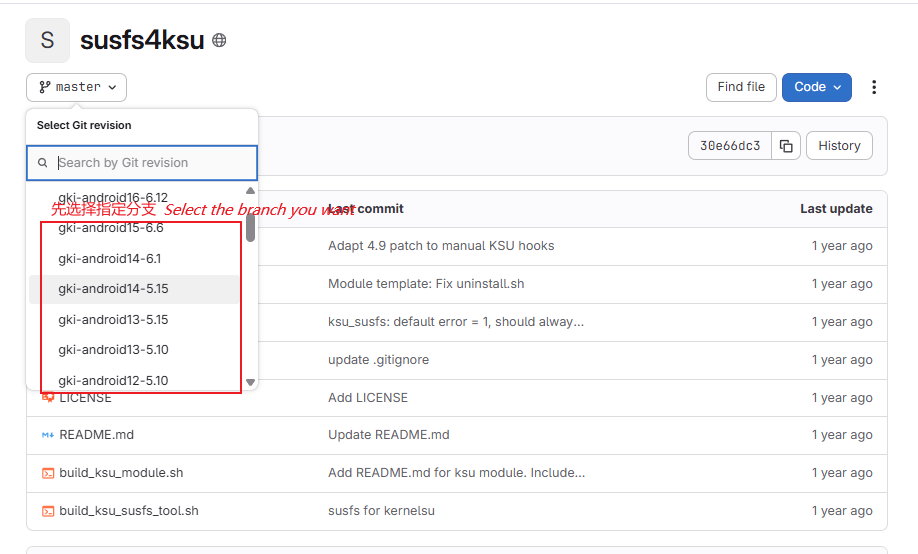
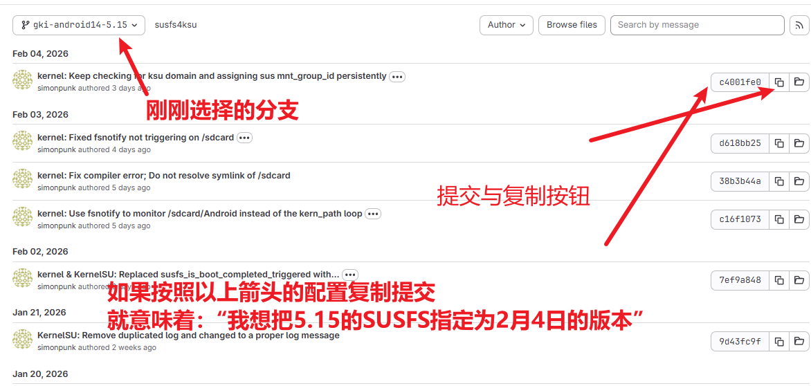

<div align="center">

# GKI KernelSU SUSFS
### 🏮 2026 🐎 С Новым годом! 🏮

**Автоматическая сборка ядер GKI | KernelSU + SUSFS**

[](https://github.com/zzh20188/GKI_KernelSU_SUSFS/releases)
[](http://www.coolapk.com/u/11253396)
[](https://kernelsu.org/)
[](https://gitlab.com/simonpunk/susfs4ksu)

[**English**](README-EN.md) | Русский

---

</div>

## 🚀 Быстрая навигация

- 📖 [Документация](https://github.com/zzh20188/GKI_KernelSU_SUSFS/wiki)
- 📥 [Скачать](https://github.com/zzh20188/GKI_KernelSU_SUSFS/releases)
- 🔰 [Инструкция](https://zzh20188.github.io/GKI_KernelSU_SUSFS/guide.html)

---

## ⚠️ Совместимость

> **Внимание:** OnePlus с ColorOS 14/15 пока не поддерживаются; после прошивки может потребоваться очистка данных.
>
> **Последняя версия SukiSU:** сборка снова работает, но несовместима с 6.12.
>
> Добавлены сборки со старыми версиями SukiSU. Для старого ядра лучше использовать менеджер той же версии: старые сборки полностью используют прежний код SukiSU и SUSFS, поэтому не содержат новых функций и исправлений.
>
> 

---

## 📚 Документация и руководства

Подробности — в [**GitHub Wiki (на английском и китайском)**](https://github.com/zzh20188/GKI_KernelSU_SUSFS/wiki).

В Wiki есть:
- [**🔰 Инструкция**](https://zzh20188.github.io/GKI_KernelSU_SUSFS/guide.html)
- 📥 Скачивание и прошивка ядра
- 💡 Полезные советы
- 🆘 Восстановление после «кирпича»
- 📊 Совместимость версий ядра

---

## 🛡️ Исправление GhostLock

GhostLock — группа опасных уязвимостей ядра Linux, включая `CVE-2026-43499` и `CVE-2026-53163`. Атакующему не нужны root-права или дополнительные модули ядра: достаточно запустить обычное приложение или локальный код на устройстве.

### Возможный ущерб

- **Падение или принудительная перезагрузка:** обычное приложение может вызвать крах ядра, из-за чего устройство перестанет нормально работать, а несохранённые данные будут потеряны.
- **Локальное повышение привилегий:** более сложная эксплуатация позволяет обойти границы Android и получить права уровня ядра, а затем полностью контролировать устройство.
- **Готовые эксплойты уже публичны:** существуют PoC для отказа в обслуживании и полная цепочка повышения привилегий для Android ARM64, так что риск уже не теоретический.
- **Надёжного временного обхода нет:** ограничения прав, изоляция приложений и усиление системы лишь усложняют атаку, но не предотвращают крах или иную эксплуатацию.

Уязвимость нельзя активировать удалённо по сети, но вредоносные приложения, недоверенные программы в общей среде или атакующий, уже получивший выполнение кода через другую уязвимость, могут использовать её дальше. Поэтому особенно осторожно устанавливайте приложения, модули и скрипты из неизвестных источников.

Проект умеет проверять и применять полное исправление при сборке ядер 5.10, 5.15, 6.1, 6.6 и 6.12. Опция по умолчанию выключена; чтобы включить защиту GhostLock, при запуске сборки выберите «Применить цепочку исправлений CVE-2026-43499 (rtmutex)». Исправления обеих уязвимостей должны присутствовать одновременно — workflow делает это автоматически; ядра, где исправление уже есть, повторно не патчатся.

Исправление проверено [полной сборкой 84 версий ядра](https://github.com/zzh20188/GKI_KernelSU_SUSFS/actions/runs/29509099128). О принципе уязвимости, затронутых версиях, публичных эксплойтах и мерах защиты читайте статью CIQ: [GhostLock Mitigation](https://kb.ciq.com/article/rocky-linux/rl-ghostlock-mitigation).

---

## 🧪 Поддержка контейнеров Droidspaces (экспериментально)

> **Экспериментальная функция:** успешная сборка и загрузка гарантированы не для всех версий GKI; перед прошивкой обязательно сохраните Boot-образ.
>
> **Совет:** workflow использует [официальные патчи](https://github.com/ravindu644/Droidspaces-OSS/tree/main/Documentation/resources/kernel-patches/GKI) [Droidspaces](https://github.com/ravindu644/Droidspaces-OSS). Если есть патч лучше — создайте issue. Патчей три, поэтому может потребоваться подобрать подходящий под вашу модель; ориентируйтесь на чужой опыт и практику.

[Droidspaces](https://github.com/ravindu644/Droidspaces-OSS) — лёгкий инструмент Linux-контейнеров, позволяющий запускать полноценное Linux-окружение на Android (systemd, OpenRC и т.д.) для разработки, серверов и других задач.

**Поддерживаемые версии:** 5.10 / 5.15 / 6.1 / 6.6 / 6.12

**Как включить:** при ручном запуске сборки выберите опцию «Поддержка контейнеров Droidspaces»:

| Опция | Описание |
|:---:|:---|
| `off` | Выключено (по умолчанию) |
| `678` | Патч для слотов 6_7_8 (рекомендуется) |
| `123` | Патч для слотов 1_2_3 (запасной) |
| `345` | Патч для слотов 3_4_5 (запасной) |

> **Подсказка:** для ядра 6.12 есть только один патч; выбирайте любой вариант, кроме `off`.

**Если сборка упала или устройство уходит в bootloop:** попробуйте другой слот-патч (например, 678 → 123 или 345) — разным подверсиям ядра могут подходить разные патчи.

## 🔧 Настройка собственных коммитов

В файле [`config/config`](config/config) можно указать конкретные коммиты SUSFS и SukiSU.

**Что такое коммит?**

Коммит — это хеш-строка, обозначающая состояние репозитория в определённый момент. Например, если указать для sukisu `4b8644515fe6d87a109129e590ccd9d33a855dca`, ядро будет собрано с версией SukiSU от 30 января.

**Зачем указывать коммит?**

- Если обновление upstream внесло баг или проблему совместимости, можно откатиться к стабильной версии.
- Если версии SUSFS и SukiSU не синхронизированы и сборка падает, можно вручную выбрать совместимые версии.

**Как получить хеш коммита?**

- SUSFS: [susfs4ksu](https://gitlab.com/simonpunk/susfs4ksu)
- SukiSU: [SukiSU-Ultra commits/builtin](https://github.com/SukiSU-Ultra/SukiSU-Ultra/commits/builtin/)

На примере SUSFS: выберите ветку и скопируйте хеш нужного коммита.




```ini
# Включить собственные коммиты
custom=true

# Хеши коммитов для веток SUSFS
gki-android12-5.10=
gki-android13-5.15=
gki-android14-6.1=
gki-android15-6.6=
gki-android16-6.12=

# Хеш коммита SukiSU
sukisu=
```

> Пустая строка означает «использовать последний коммит этой ветки». При `custom=false` (по умолчанию) всегда берётся последний tip ветки.

---

## 🧪 Маскировка `/proc/config.gz` (Stock Config)

Это продвинутый приём, переключатель в workflow не нужен.
При сборке автоматически проверяется наличие `config/stock_defconfig`: если файл есть — он применяется, если нет — шаг пропускается.

Как использовать:
1. Убедитесь, что на устройстве официальная ROM и официальное ядро.
2. Получите `/proc/config.gz` с устройства (на телефоне или на компьютере).
3. Распакуйте, переименуйте в `stock_defconfig`, загрузите в каталог [`config/`](config/) репозитория и закоммитьте (можно прямо с телефона).

Сборка автоматически:
- скопирует файл в исходники ядра: `$KERNEL_ROOT/common/arch/arm64/configs/stock_defconfig`;
- в `$KERNEL_ROOT/common/kernel/Makefile` переключит правило `$(obj)/config_data` с `$(KCONFIG_CONFIG)` на `arch/arm64/configs/stock_defconfig`;
- благодаря этому `/proc/config.gz` в собранном ядре будет ближе к официальной конфигурации.

---

## 🛠️ Рекомендуемые дополнения

### 📦 Модули

<table>
<tr>
<th>Название</th>
<th>Репозиторий</th>
<th>Канал</th>
</tr>
<tr>
<td><b>LSPosed-Irena</b></td>
<td><a href="https://github.com/re-zero001/LSPosed-Irena">GitHub</a></td>
<td><a href="https://t.me/lsposed_irena">Telegram</a></td>
</tr>
<tr>
<td><b>Zygisk Next</b></td>
<td><a href="https://github.com/Dr-TSNG/ZygiskNext">GitHub</a></td>
<td rowspan="2"><a href="https://t.me/real5ec1cff">Telegram</a></td>
</tr>
<tr>
<td><b>TrickyStore</b></td>
<td><a href="https://github.com/5ec1cff/TrickyStore">GitHub</a></td>
</tr>
</table>

### 🔧 Модули Xposed

| Модуль | Описание |
|:---:|:---|
| **FuseFixer** | [Модуль исправления zero-width Unicode](https://t.me/real5ec1cff/268) |

### Приложения

| Название | Описание |
|:---:|:---|
| **Scene** | [Официальный сайт](https://omarea.com/#/) |

---

<div align="center">

**Проект продолжает развиваться...**

⭐ Если проект оказался полезен, поставьте Star!

</div>
